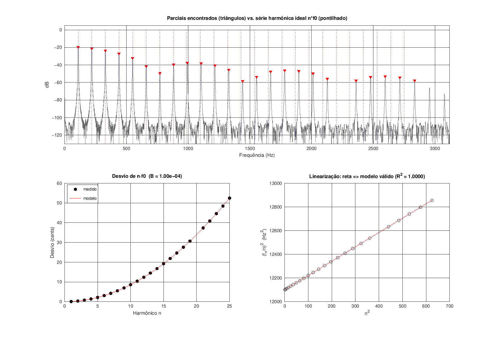
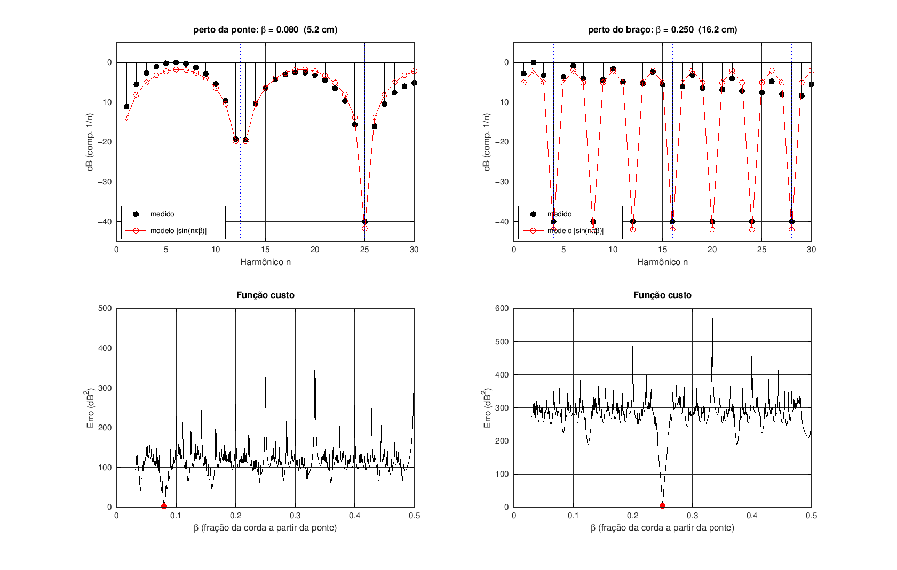
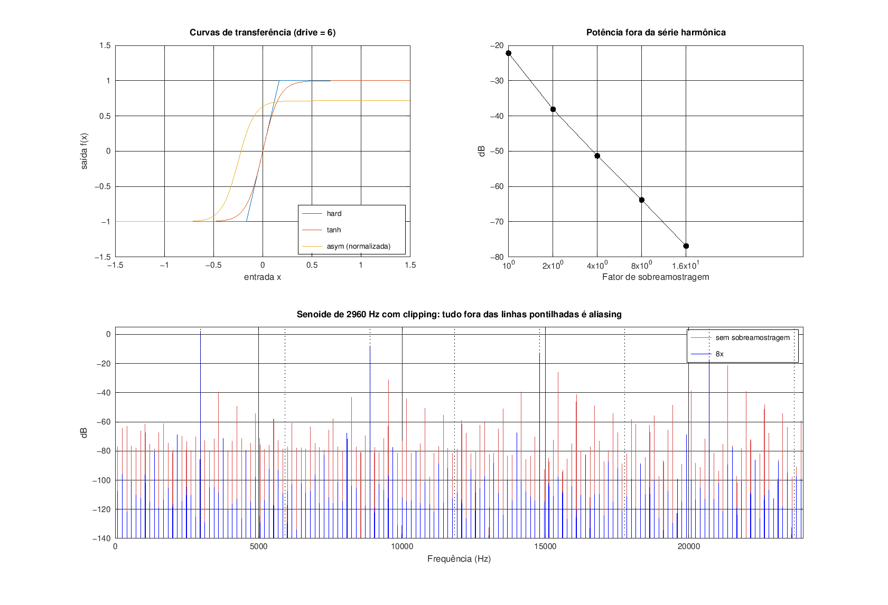
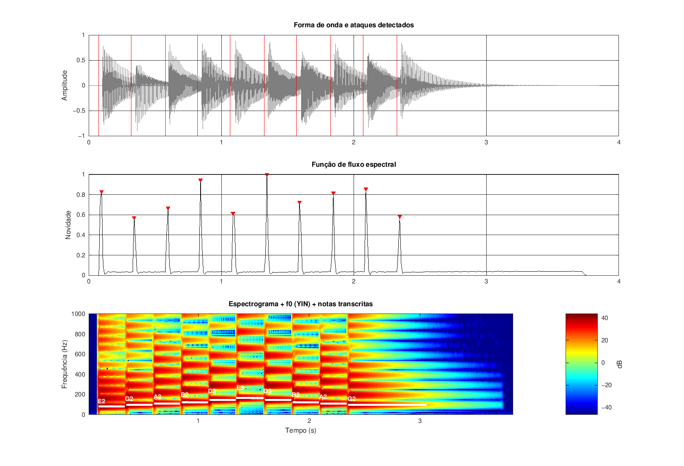

# 🎸 Guitar Signals Lab

**Sinais e Sistemas aplicados ao violão e à guitarra, em GNU Octave.**

Nove experimentos que partem de uma nota tocada e chegam a um amplificador digital simplificado. Cada experimento responde a **uma pergunta concreta**, mede o resultado com **números** (não só gráficos) e gera **áudios** de antes e depois para ouvir.

O projeto vem com um gerador de sinais sintéticos cujos parâmetros são **conhecidos de antemão**. Assim cada algoritmo é validado contra a resposta certa antes de ser usado em gravações reais.

```
octave-cli --eval "run_all;"
```

Em ~20 s isso gera 11 figuras, 11 áudios e um relatório em Markdown (`results/REPORT.md`) com todas as métricas.

---

## Sumário

1. [O que o projeto mostra](#1-o-que-o-projeto-mostra)
2. [Instalação e execução](#2-instalação-e-execução)
3. [Estrutura do projeto](#3-estrutura-do-projeto)
4. [Os experimentos](#4-os-experimentos)
5. [Validação com sinais sintéticos](#5-validação-com-sinais-sintéticos)
6. [Usando suas próprias gravações](#6-usando-suas-próprias-gravações)
7. [Configuração](#7-configuração)
8. [Como adicionar um experimento](#8-como-adicionar-um-experimento)
9. [Limitações conhecidas](#9-limitações-conhecidas)
10. [Ideias de extensão](#10-ideias-de-extensão)
11. [Referências](#11-referências)

---

## 1. O que o projeto mostra

| # | Experimento | Conceito de Sinais e Sistemas | Resultado principal |
|---|---|---|---|
| 01 | Tempo, frequência e tempo-frequência | DFT, janelamento, STFT, envoltória | f0, ataque, fator de crista, centroide |
| 02 | Filtros LTI e timbre | Butterworth, polos/zeros, fase, atraso de grupo | −3 dB medido, filtfilt vs filter |
| 03 | Harmônicos e inarmonicidade | Série de Fourier, estimação de pico, mínimos quadrados | Coeficiente de inarmonicidade **B** da corda |
| 04 | Decaimento dos parciais | Decaimento exponencial, STFT, regressão em dB | **T60** de cada harmônico |
| 05 | Onde a corda foi palhetada? | **Filtro pente**, problema inverso | Distância da ponte em **cm** |
| 06 | Ressíntese com Karplus-Strong | Sistema **recursivo** (IIR), função de transferência, atraso fracionário | Nota sintética calibrada pela gravação |
| 07 | Distorção e aliasing | Sistema **não linear**, amostragem, sobreamostragem | Aliasing de −22 dB → −77 dB |
| 08 | Caixa por resposta ao impulso | **Convolução**, LTI = h[n], complexidade O(NM) vs O(N log M) | Até 34× mais rápido via FFT |
| 09 | Transcrição de um riff | Fluxo espectral, rastreamento de f0 | Notas e ritmo recuperados automaticamente |

O fio condutor é **guitarra → análise → modelo → síntese → efeitos**. Os experimentos 01–05 estudam *o sinal*, o 06 constrói *um modelo do sistema que o gera*, e os 07–08 montam *a cadeia de processamento de um amplificador*.

<p align="center">
  <br>
  <em>EX03: os parciais de uma corda ficam progressivamente acima de n·f0. Linearizando o modelo, o ajuste vira uma reta.</em>
</p>

---

## 2. Instalação e execução

### Requisitos

- **GNU Octave 7 ou mais recente** (testado no 8.4)
- Pacote **signal** (`butter`, `freqz`, `filtfilt`, `resample`, `zplane`)

```bash
# Ubuntu/Debian
sudo apt install octave octave-signal

# Ou, dentro do Octave, em qualquer sistema:
pkg install -forge control signal
```

### Rodando

Na pasta do projeto:

```octave
run_all            % todos os experimentos
run_all([3 4 5])   % apenas alguns
```

Ou pelo terminal, sem abrir a interface:

```bash
octave-cli --eval "run_all;"
```

Na primeira execução, os WAVs de `audio/` que estiverem faltando são **gerados automaticamente** (veja [§5](#5-validação-com-sinais-sintéticos)).

### Rodando um experimento isolado (para estudar ou depurar)

```octave
cfg = setup_paths();          % path + pacote signal + pastas de saída
cfg.show_figures = true;      % abre as janelas em vez de só salvar PNG
res = ex05_pluck_position(cfg);
```

### Saídas

```
results/
├── REPORT.md     ← relatório com perguntas, tabelas de métricas, figuras e links de áudio
├── figures/      ← ex01_time.png, ex02_responses.png, ...
└── audio/        ← ex02_lp.wav, ex06_karplus_strong.wav, ex07_dist_com_os.wav, ...
```

---

## 3. Estrutura do projeto

```
guitar-signals-lab/
├── run_all.m                  # ponto de entrada: roda tudo e escreve o relatório
├── setup_paths.m              # configura path, carrega 'signal', cria pastas
├── config/
│   └── lab_config.m           # TODOS os parâmetros (arquivos, janelas, filtros, drive...)
├── experiments/               # um arquivo por experimento; cada um devolve um struct 'res'
│   ├── ex01_time_frequency.m
│   ├── ...
│   └── ex09_riff_transcription.m
├── lib/
│   ├── core/                  # E/S de áudio, FFT, STFT, utilitários de figura e relatório
│   ├── analysis/              # YIN, harmônicos, inarmonicidade, T60, onsets, posição da palhetada
│   ├── synth/                 # síntese aditiva "física" e Karplus-Strong
│   ├── fx/                    # waveshaper, convolução com IR, IRs sintéticas
│   └── plot/                  # espectro e espectrograma
├── tools/
│   ├── generate_test_signals.m  # cria WAVs sintéticos + gabarito
│   └── write_report.m           # gera results/REPORT.md
├── audio/                     # seus WAVs (ou os sintéticos) + ground_truth.txt
└── docs/img/                  # figuras usadas neste README
```

### Princípios de organização

- **Biblioteca separada dos experimentos.** As funções em `lib/` não plotam nem leem `cfg`: recebem sinais e devolvem números. Dá para reutilizá-las em outro projeto e testá-las isoladamente.
- **Nenhum número mágico nos experimentos.** Cortes de filtro, janelas, drive etc. vêm de `lab_config.m`.
- **Algoritmos escritos à mão onde isso ensina algo.** STFT, YIN, detecção de ataques e ajuste de inarmonicidade são implementações próprias e comentadas. Funções prontas (`butter`, `resample`, `fftfilt`) são usadas onde o foco do experimento é outro.
- **Saída padronizada.** Todo experimento devolve `res` com `question`, `metrics`, `figures`, `audio` e `notes`, e `write_report` transforma isso no relatório.

---

## 4. Os experimentos

Cada seção traz o objetivo, a teoria mínima, o que observar na figura e perguntas que valem a pena discutir num relatório.

### EX01: Tempo, frequência e tempo-frequência

**Pergunta:** como a mesma nota aparece em cada domínio, e o que cada visão revela que as outras escondem?

**Teoria.** No tempo vemos a *envoltória*: um ataque de poucos milissegundos seguido de um decaimento longo. A DFT de um trecho estável mostra a *série harmônica*: picos em ≈ n·f0. Mas ela é uma média e não diz *quando* cada componente existe. A STFT resolve isso fatiando o sinal em janelas curtas:

$$X[k, m] = \sum_{n} x[n + mH]\, w[n]\, e^{-j 2\pi k n / N}$$

A janela de Hann `w[n]` reduz o vazamento espectral. O preço é um lóbulo principal mais largo, que é o compromisso entre resolução em tempo e resolução em frequência.

**Métricas:** duração, pico e RMS (dBFS), fator de crista, tempo de ataque 10→90 %, f0 (YIN), nota mais próxima em cents, centroide espectral.

**Observe:** no espectrograma, os harmônicos agudos somem antes dos graves. O EX04 mede isso.

> 💬 *Para discutir:* por que o fator de crista de uma nota dedilhada é tão alto (~20 dB)? O que um compressor faria com ele?

---

### EX02: Filtros LTI e timbre

**Pergunta:** como filtros mudam o timbre, e qual a diferença prática entre filtragem causal (`filter`) e de fase zero (`filtfilt`)?

**Teoria.** Três Butterworth de 4ª ordem: passa-baixa (3 kHz, como um cabo longo ou captador escuro), passa-alta (120 Hz) e passa-faixa (700–3500 Hz, "presença"). A figura mostra magnitude, fase, **atraso de grupo** e o **diagrama de polos e zeros**.

$$\tau_g(\omega) = -\frac{d\phi(\omega)}{d\omega}$$

O atraso de grupo diz quanto cada faixa de frequência é atrasada. Um filtro causal atrasa o sinal, e mais perto do corte. `filtfilt` filtra para frente e para trás: a fase se cancela (fase zero) e a magnitude fica ao quadrado. Isso é possível offline, mas não em tempo real.

**Métricas:** frequência de −3 dB projetada × medida na resposta, centroide antes e depois, atraso de grupo no centro da banda e o máximo.

**Áudios:** `ex02_lp.wav`, `ex02_hp.wav`, `ex02_bp.wav`.

> 💬 *Para discutir:* por que o passa-alta tem o maior atraso de grupo máximo (~5 ms) se o corte dele é o mais baixo? *Dica:* atraso de grupo é medido em segundos, e períodos em baixa frequência são longos.

---

### EX03: Harmônicos e inarmonicidade

**Pergunta:** os parciais de uma corda real são múltiplos exatos de f0?

**Teoria.** Uma corda ideal (perfeitamente flexível) vibra em n·f0. Uma corda real tem **rigidez à flexão**, que age como uma força restauradora extra, maior em modos de comprimento de onda curto. O resultado (Fletcher, 1964):

$$f_n = n f_0 \sqrt{1 + B n^2}$$

**Truque de linearização.** Elevando ao quadrado e dividindo por n²:

$$\left(\frac{f_n}{n}\right)^2 = f_0^2 + (f_0^2 B)\, n^2$$

Isso é uma **reta** em n². Então f0 e B saem de mínimos quadrados lineares (`X \ y`), sem otimização não linear. O R² do ajuste diz se o modelo é adequado.

**Algoritmos** (`lib/analysis/`):
- `yin_f0.m`: estimativa inicial de f0 (YIN, com a função diferença calculada via FFT em O(N log N));
- `find_harmonics.m`: busca **adaptativa** de picos. A posição esperada do parcial n é extrapolada dos parciais n−1 e n−2 (porque eles não estão em n·f0), com interpolação parabólica para precisão sub-bin;
- `fit_inharmonicity.m`: a regressão acima.

**Métricas:** f0 por YIN e por ajuste, afinação em cents, B, R², desvio do maior parcial.

> 💬 *Para discutir:* com B = 10⁻⁴, o 25º parcial fica ~50 cents (meio semitom!) acima de 25·f0. Que consequência isso tem para afinar por harmônicos? E por que pianos usam "afinação esticada"?

---

### EX04: Decaimento dos parciais (T60)

**Pergunta:** todos os harmônicos morrem juntos?

**Teoria.** Cada parcial decai aproximadamente como exponencial, $A_n(t) = A_n e^{-t/\tau_n}$. Em dB, isso é uma **reta**:

$$L_n(t) = L_n(0) - \frac{20}{\ln 10}\frac{t}{\tau_n} \quad\Rightarrow\quad T_{60} = -\frac{60}{\text{inclinação (dB/s)}}$$

`harmonic_decay.m` acompanha o nível de cada parcial na STFT, com uma janela de ~8 períodos para separar harmônicos vizinhos. Depois ajusta uma reta ao trecho entre o pico −3 dB e ~40 dB abaixo, parando antes do ruído de fundo.

**Métricas:** T60 do fundamental e dos harmônicos 2, 5 e 10, razão T60(1)/T60(último).

> 💬 *Para discutir:* quais mecanismos físicos fazem os agudos perderem energia mais rápido (atrito interno, ar, acoplamento com o tampo)? Como isso aparece no filtro do laço do Karplus-Strong (EX06)?

---

### EX05: Onde a corda foi palhetada?

**Pergunta:** só pelo áudio, dá para descobrir a que distância da ponte a corda foi tocada?

**Teoria.** Uma corda ideal palhetada na fração β do comprimento (medida a partir da ponte) tem amplitudes harmônicas

$$A_n \propto \frac{|\sin(n \pi \beta)|}{n}$$

O fator $\sin(n\pi\beta)$ é um **filtro pente**: ele anula todo harmônico em que nβ é inteiro. Tocando a 1/4 da corda, somem os harmônicos 4, 8, 12… É por isso que palhetar perto do braço soa "redondo" e perto da ponte soa "anasalado".

**Problema inverso.** `fit_pluck_position.m` compensa o fator 1/n, normaliza e procura numa grade fina o β que minimiza o erro quadrático em dB. O ganho fica livre e há saturação em −40 dB, porque o fundo de um notch real é limitado pelo ruído.

<p align="center">
  <br>
  <em>Esquerda: perto da ponte (β = 0,08, 5,2 cm). Direita: perto do braço (β = 0,25), com notches nos harmônicos 4, 8, 12...</em>
</p>

> 💬 *Para discutir:* a função custo tem mínimos secundários. De onde eles vêm? E por que o método é mais confiável numa janela logo após o ataque do que no meio da nota?

---

### EX06: Ressíntese com Karplus-Strong

**Pergunta:** um filtro recursivo com 4 parâmetros (f0, T60, brilho, posição) consegue imitar a nota gravada? Onde ele falha?

**Teoria.** O Karplus-Strong é um **sistema LTI com realimentação**: uma linha de atraso de L amostras (a "corda") com um filtro de perdas no laço.

```
x[n] ──(+)─────────────────────────────┬──▶ y[n]
        ▲                              │
        └── g · Hlp(z) · Hap(z) · z^-L ◀┘
```

$$H(z) = \frac{1}{1 - g\, H_{lp}(z)\, H_{ap}(z)\, z^{-L}}, \qquad H_{lp} = \frac{1 + z^{-1}}{2}, \qquad H_{ap} = \frac{C + z^{-1}}{1 + C z^{-1}}$$

Multiplicando por $(1 + Cz^{-1})$, H(z) vira uma razão de polinômios e a síntese inteira é **uma linha**: `y = filter(b, a, excitação)`. Nada de laço amostra a amostra.

- **Afinação:** o laço atrasa $L + 0{,}5 + d$ amostras. O passa-baixa contribui com 0,5, e o **passa-tudo** contribui com um atraso fracionário $d$, com $C = (1-d)/(1+d)$. Sem ele, o período fica preso a valores inteiros e notas agudas desafinam.
- **Decaimento:** a cada período o fundamental é multiplicado por $g\cos(\pi f_0/f_s)$. Impondo −60 dB em T60 segundos, $g = 10^{-3/(f_0 T_{60})} / \cos(\pi f_0 / f_s)$.
- **Excitação:** um período de ruído, passado por um passa-baixa (brilho) e por um pente (posição da palhetada, a mesma ideia do EX05).

**Calibração:** f0 e T60 vêm da gravação (EX03/EX04). O brilho é escolhido por busca, para casar o centroide espectral.

**Métricas:** ganho g, erro de afinação com e sem passa-tudo (em 110 Hz e em 659 Hz), T60 gravado × sintetizado, erro de timbre (RMS em dB das amplitudes dos 10 primeiros harmônicos).

**Áudios:** `ex06_original.wav`, `ex06_karplus_strong.wav`, `ex06_karplus_strong_sem_allpass.wav`.

> 💬 *Para discutir:* o KS é perfeitamente harmônico, B = 0. Compare com o EX03. Como um passa-tudo de **dispersão** dentro do laço poderia reproduzir a inarmonicidade?

---

### EX07: Distorção, aliasing e sobreamostragem

**Pergunta:** por que distorção digital "ingênua" soa áspera? E de onde vêm os harmônicos pares?

**Teoria.** Uma distorção sem memória $y = f(x)$ é **não linear**: aplicada a uma senoide, ela cria harmônicos que podem passar de $f_s/2$. Em tempo discreto, esses harmônicos **dobram** (aliasing) para frequências que *não* são múltiplas de f0, e isso é ouvido como aspereza. Solução clássica: **sobreamostrar** (subir a taxa por M), distorcer, filtrar e voltar.

O experimento usa uma senoide de 2960 Hz e mede a **potência fora da série harmônica**. Por construção, essa potência é aliasing:

| Sobreamostragem | 1× | 2× | 4× | 8× | 16× |
|---|---|---|---|---|---|
| Aliasing (hard clip) | −22 dB | −38 dB | −51 dB | −64 dB | −77 dB |

Cerca de 13 dB a cada dobra, ao custo de mais processamento.

**Simetria e paridade.** Se $f(-x) = -f(x)$ (tanh, clipping simétrico), a saída só tem harmônicos **ímpares**. Uma curva **assimétrica** (polarização, como numa válvula) gera harmônicos **pares**. O experimento mede a razão pares/ímpares: ~−107 dB para tanh e ~+6 dB para asym.

<p align="center">
  <br>
  <em>Em vermelho, sem sobreamostragem: dezenas de componentes fora das linhas pontilhadas (os harmônicos legítimos).</em>
</p>

**Áudios:** `ex07_di.wav`, `ex07_dist_sem_os.wav`, `ex07_dist_com_os.wav`. A diferença é mais audível com drive alto e notas agudas.

---

### EX08: Caixa por resposta ao impulso (convolução)

**Pergunta:** como uma resposta ao impulso substitui a caixa do amplificador, e quanto a FFT economiza?

**Teoria.** Um sistema LTI é **completamente** descrito pela sua resposta ao impulso:

$$y[n] = (x * h)[n] = \sum_{k=0}^{M-1} h[k]\, x[n-k]$$

É assim que simuladores de amplificador "capturam" caixas e salas: tocam um impulso (ou uma varredura) e gravam a saída. A convolução direta custa O(M) por amostra. Já a **overlap-add** com FFT (`fftfilt`) custa O(log M).

**Cadeia:** DI → distorção (com sobreamostragem) → convolução com a IR da caixa.

| IR | Direta | FFT | Ganho |
|---|---|---|---|
| 50 ms | ~30 ms | ~5 ms | ~5× |
| 500 ms | ~300 ms | ~9 ms | ~34× |

*(tempos para 1 s de áudio; variam com a máquina; erro relativo entre os métodos ~10⁻¹⁴)*

**Métricas:** energia acima de 6 kHz sem e com caixa (o "chiado" da distorção, que cai ~15 dB) e o centroide. O centroide pode *subir*, porque a caixa também corta o grave abaixo de ~80 Hz, um bom exemplo de que uma métrica só não conta a história toda.

---

### EX09: Transcrição automática de um riff

**Pergunta:** combinando detecção de ataques e rastreamento de f0, dá para recuperar notas e ritmo?

**Teoria.**
- **Fluxo espectral** (`onset_detect.m`): soma dos *aumentos* de log-magnitude entre quadros da STFT. Um ataque injeta energia nova em muitas frequências ao mesmo tempo e gera um pico. Os picos são aceitos acima de um limiar adaptativo (mediana móvel + δ).
- **Rastreamento de f0** (`pitch_track.m`): YIN quadro a quadro, com gate de energia.
- **Segmentação:** a nota de cada trecho entre ataques é a mediana do f0, ignorando os primeiros 30 ms (o ataque é ruidoso).

<p align="center">
  <br>
  <em>Pentatônica de Mi menor: 10/10 ataques e 10/10 notas corretos no sinal sintético.</em>
</p>

**Métricas:** número de ataques, intervalo mediano, andamento estimado, notas transcritas e, quando há gabarito, precisão e revocação dos ataques (tolerância ±50 ms).

> 💬 *Para discutir:* o que quebraria este método em acordes (várias f0 simultâneas)? E em legato/hammer-on, onde não há ataque de palheta?

---

## 5. Validação com sinais sintéticos

`tools/generate_test_signals.m` cria notas por **síntese aditiva com física simplificada** (`synth_plucked_string.m`): parciais com inarmonicidade, amplitudes pelo pente da palhetada, T60 decrescente com a frequência, clique de palheta e ruído de fundo. Os valores verdadeiros ficam em `audio/ground_truth.txt`.

Isso transforma o projeto num **experimento controlado**: antes de interpretar uma gravação, sabemos que o algoritmo acerta quando a resposta é conhecida.

| Grandeza | Verdadeiro | Medido |
|---|---|---|
| f0 (ajuste dos parciais) | 110,000 Hz | 110,000 Hz |
| Coeficiente B | 1,0 × 10⁻⁴ | 1,000 × 10⁻⁴ |
| T60 fundamental / 2º / 10º | 3,00 / 2,78 / 1,74 s | 3,00 / 2,78 / 1,74 s |
| β perto da ponte / do braço | 0,080 / 0,250 | 0,080 / 0,250 |
| Ataques do riff (±50 ms) | 10 | 10 (100 % / 100 %) |
| Notas do riff | E2 G2 A2 B2 D3 E3 D3 B2 A2 G2 | idem |

> ⚠️ **Acertar sinais sintéticos é necessário, mas não suficiente.** O sintetizador usa os mesmos modelos que os estimadores. O teste de verdade é com gravações (§6), onde aparecem ruído, ressonâncias do corpo, captadores e variação de execução. A discussão dessa diferença é a parte mais interessante de um relatório.

---

## 6. Usando suas próprias gravações

Coloque os WAVs em `audio/` com os nomes de `lab_config.m` (ou mude os nomes lá). Arquivos existentes **nunca** são sobrescritos pelo gerador.

| Arquivo | O que gravar | Dica |
|---|---|---|
| `nota.wav` | Uma nota isolada deixada soar até o fim (ex.: 5ª corda solta, Lá2) | Abafe as outras cordas; ≥ 3 s |
| `nota_ponte.wav` | A mesma nota, palhetada a ~5 cm da ponte | Meça a distância com régua para comparar |
| `nota_braco.wav` | A mesma nota, palhetada sobre a boca/braço | Idem |
| `riff.wav` | Notas simples, uma de cada vez | Comece sem acordes |
| `gtr_DI.wav` | Sinal direto (interface de áudio ou direct box) | Sem pedais nem amp |
| `cab_IR.wav` | Resposta ao impulso de caixa | Há IRs gratuitas na internet; qualquer fs serve (é reamostrada) |

**Boas práticas de gravação**
- 44,1 ou 48 kHz, 24 bits, mono.
- Pico entre −12 e −6 dBFS: sem clipping, com folga.
- Silêncio curto antes da nota (ajuda os ataques e o gate).
- Violão: microfone a ~20–30 cm do 12º traste. Guitarra: DI.
- Grave **várias tomadas** e reporte média ± desvio padrão. Uma medida só não é resultado.

**Ajustes que você talvez precise fazer em `lab_config.m`**
- `analysis.steady_start`: aumente se o ataque da sua gravação for longo.
- `analysis.f0_min / f0_max`: restrinja à faixa da sua nota para o YIN errar menos (erros de oitava).
- `guitar.scale_length_cm`: 64,8–65 cm em violão clássico, 62,9 (Gibson) ou 64,8 (Fender).

---

## 7. Configuração

Todos os parâmetros ficam em [`config/lab_config.m`](config/lab_config.m), agrupados por assunto:

| Grupo | Principais campos |
|---|---|
| `cfg.files.*` | nomes dos WAVs de entrada |
| `cfg.show_figures` | `true` abre janelas; `false` só salva PNG (padrão, bom para servidor) |
| `cfg.guitar.*` | escala em cm, referência A4 |
| `cfg.analysis.*` | faixa e limiar do YIN, janela da STFT, trechos "estável" e "inicial", nº de harmônicos |
| `cfg.filters.*` | ordem e cortes LP/HP/BP |
| `cfg.ks.*` | posição da palhetada e grade de brilho do Karplus-Strong |
| `cfg.fx.*` | drive, tipo de curva, sobreamostragem, tom de teste, tamanhos de IR do benchmark |

---

## 8. Como adicionar um experimento

1. Crie `experiments/ex10_meu_experimento.m`:

   ```octave
   function res = ex10_meu_experimento(cfg)
     res = new_result('ex10', 'Título curto', 'Qual pergunta isto responde?');
     [x, fs] = load_mono(cfg, cfg.files.note);

     % ... análise usando funções de lib/ ...

     fig = new_fig(cfg, 'ex10');
     plot(...);
     res.figures{end+1} = save_fig(cfg, fig, 'ex10_algo');
     res = add_metric(res, 'Minha métrica', valor, '%.2f Hz', 'comentário opcional');
   end
   ```

2. Acrescente `@ex10_meu_experimento` à lista `exps` em `run_all.m`.

Pronto: ele entra no relatório automaticamente. Coloque funções reutilizáveis em `lib/` e parâmetros em `lab_config.m`.

---

## 9. Limitações conhecidas

- **Monofônico.** YIN e a transcrição assumem uma nota por vez.
- **Modelo de corda ideal no EX05.** O corpo do instrumento e, na guitarra elétrica, a **posição do captador** criam outros filtros pente que se misturam ao da palhetada.
- **Karplus-Strong sem dispersão.** Parciais perfeitamente harmônicos e uma única lei de perdas.
- **Distorção sem memória.** Amplificadores reais têm filtros antes e depois do estágio não linear, além de dependência da envoltória (*sag*). O modelo aqui é o mais simples possível.
- **Gráficos via gnuplot** em ambientes sem display: alguns símbolos TeX não são suportados (por isso os títulos usam `*` em vez de `·`).

---

## 10. Ideias de extensão

Em ordem aproximada de dificuldade:

- **Afinador em tempo real** com `audiorecorder` + YIN.
- **Comparar estimadores de f0**: autocorrelação, HPS, cepstrum × YIN, medindo erro de oitava em gravações.
- **Medir B de todas as seis cordas** e relacionar com o diâmetro e o material (encordoamento nu × revestido).
- **Karplus-Strong com dispersão**: cascata de passa-tudos no laço para reproduzir o B medido no EX03.
- **Captura da sua própria IR**: varredura senoidal exponencial (método de Farina) tocada num alto-falante e gravada com microfone.
- **Distorção com filtros**: pré-ênfase → não-linearidade → de-ênfase (modelo tipo Tube Screamer) e comparação de espectros.
- **Wah-wah**: passa-faixa ressonante com centro variando no tempo, um sistema **linear variante no tempo**.
- **Teste de escuta ABX** entre gravação e Karplus-Strong, com análise estatística das respostas.

---

## 11. Referências

- A. V. Oppenheim, R. W. Schafer. *Discrete-Time Signal Processing*. Pearson. Base de DFT, filtros, amostragem.
- J. O. Smith III. *Physical Audio Signal Processing*. CCRMA/Stanford (livro online gratuito). Cordas, Karplus-Strong, atraso fracionário.
- K. Karplus, A. Strong (1983). "Digital Synthesis of Plucked-String and Drum Timbres". *Computer Music Journal* 7(2).
- D. A. Jaffe, J. O. Smith (1983). "Extensions of the Karplus-Strong Plucked-String Algorithm". *Computer Music Journal* 7(2).
- A. de Cheveigné, H. Kawahara (2002). "YIN, a fundamental frequency estimator for speech and music". *JASA* 111(4).
- H. Fletcher (1964). "Normal Vibration Frequencies of a Stiff Piano String". *JASA* 36(1).
- N. H. Fletcher, T. D. Rossing. *The Physics of Musical Instruments*. Springer.
- U. Zölzer (ed.). *DAFX: Digital Audio Effects*. Wiley. Distorção, convolução, efeitos.
- J. P. Bello et al. (2005). "A Tutorial on Onset Detection in Music Signals". *IEEE Trans. Speech and Audio Processing* 13(5).
- R. Bristow-Johnson. *Audio EQ Cookbook*. Fórmulas dos biquads usados na IR sintética.
